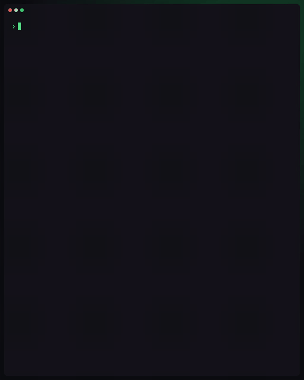
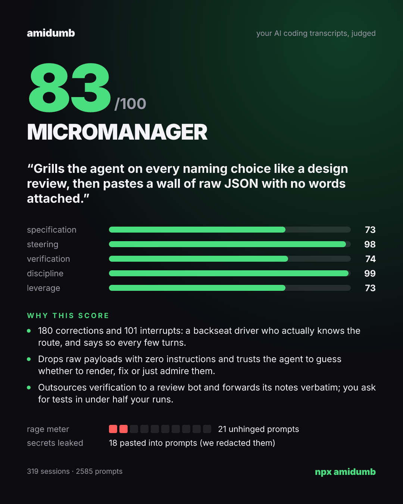

<h1 align="center">amidumb</h1>

<p align="center">
  <b>Your AI coding transcripts, judged.</b><br>
  Do you direct your coding agent like an engineer, or do you just vibecode?
</p>

<p align="center">
  <a href="https://www.npmjs.com/package/amidumb"></a>
  <a href="https://github.com/jjinendra3/amidumb/actions/workflows/ci.yml"></a>
  <a href="https://github.com/jjinendra3/amidumb/blob/master/LICENSE"></a>
</p>

```sh
npx amidumb
```

<p align="center">
  
  
</p>

amidumb reads your Claude Code and Codex history on your machine, scores how well you direct the agent from 0 to 100, gives you a title for it, gets your own `claude` to roast you, and saves a card you can post. One command, no sign-up, no API key, and the score never leaves your machine.

## What you get

- **A direction score** from 0 to 100, with five sub-scores: specification, steering, verification, discipline and leverage.
- **A title** for every 5 points of your score, from Hostage to Agent's Worst Nightmare. All twenty of them are roasts.
- **The roast**: a one-line verdict and three reasons for your score, written by your own `claude` (or `codex`). Every reason has to cite prompts that were actually sent; a reason that cites a prompt that doesn't exist is thrown out.
- **A card**: `amidumb-YYYY-MM-DD.png` (1080×1350), saved where you ran it and opened for you.
- **A rage meter**: prompts with swearing, CAPS LOCK or `!!!`.
- **A secret leak count**: API keys, tokens and passwords you've pasted into prompts.
- **Three habits to fix**, written as rules you can paste into `CLAUDE.md` or `AGENTS.md`.

## The ladder

The title comes from your score alone, one for every 5 points. It's a ladder of who's in charge: at the bottom the agent runs you, at the top you run it too hard. None of them is a compliment, the top one included.

| score | title | score | title |
|---|---|---|---|
| 95–100 | Agent's Worst Nightmare | 45–49 | Cc'd on Everything |
| 90–94 | Trust Issues | 40–44 | Mid Vibes |
| 85–89 | Control Freak | 35–39 | Along for the Ride |
| 80–84 | Micromanager | 30–34 | Vibe Tourist |
| 75–79 | Backseat Driver | 25–29 | Spectator |
| 70–74 | Hall Monitor | 20–24 | Passenger |
| 65–69 | Professional Delegator | 15–19 | Agent's Assistant |
| 60–64 | Middle Manager | 10–14 | Intern's Intern |
| 55–59 | Reluctant Manager | 5–9 | Human Clipboard |
| 50–54 | Part-Time Boss | 0–4 | Hostage |

## Is it safe to run?

- **The score is computed on your machine.** amidumb reads `~/.claude/projects` and `~/.codex/sessions`. It has no servers, no telemetry and makes no network calls of its own.
- **The roast runs on your own CLI, on your own plan.** It sends a sample of about 150 prompts to your `claude` CLI (or `codex`), and prints one line saying exactly what it's sending before it does. If that CLI isn't logged in, it says so and skips the roast.
- **Only what you typed and what the agent said.** Each prompt is cut to 500 characters and goes with the agent's message before it, cut to 300. Tool output and the files the agent read or wrote are never sent.
- **Secrets are redacted before anything is sent**: private keys, AWS, GitHub, Anthropic, OpenAI, Stripe, Slack, Google and npm keys, JWTs, and `password=`-style assignments.
- **`--dry-run`** prints exactly what would be sent, and sends nothing. **`--no-roast`** gives you the score and the card with nothing sent anywhere.
- **The judge leaves no trace.** It runs ephemeral (`claude --no-session-persistence` with no tools, `codex exec --ephemeral` in a read-only sandbox) from an empty folder, so it never ends up in the transcripts it judges.
- **The card never quotes your prompts.** It shows scores and what the judge wrote. The judge is told to leave out paths, code and names, and its text is masked again before rendering.

## FAQ

**Does it send my code?**
Not your files. If you pasted code into a prompt, the first 500 characters of that prompt can be sent, after secrets are redacted. Run `--dry-run` to see every character that would go.

**What does it cost?**
About 20–30k tokens from your own Claude or Codex plan, once per run. Nothing else.

**Can I rerun it until I get a better score?**
Rerun all you like: the same transcripts always get the same score. The score comes from a fixed rubric computed locally, never from the LLM. Only the roast's wording changes.

**I use Codex, not Claude Code.**
amidumb reads Codex sessions too. The roast uses `claude` by default; pass `--codex` to use Codex instead. If Claude Code isn't installed, it uses Codex on its own. Sub-scores built on signals Codex doesn't record are left out, not counted against you.

**My history looks short.**
Claude Code deletes transcripts after 30 days unless you raise `cleanupPeriodDays` in its settings. amidumb reads everything still on disk; `--days 30` scores just the last month.

**My score is wrong.**
Open an issue with your `npx amidumb --json` output. It's numbers only: no prompt text, titles or paths. If the numbers themselves look off, `npx amidumb survey` prints the record types and keys in your transcripts, with no content.

## How the score works (rubric v2)

**The score never comes from the LLM.** An LLM score would change on every run and go easy on whoever is paying for it. The score is a fixed, versioned rubric over signals computed locally. The LLM only writes the words.

Every prompt is classified in the context of the agent message right before it, because a short prompt isn't a dumb prompt: "yes, go" after a good plan is good direction, and "fix it" on repeat is vibecoding. Those classes feed five sub-scores, weighted into the overall score.

<details>
<summary><b>The full rubric</b></summary>

### Every prompt is judged in context

| class | what it is |
|---|---|
| specify | names a file or symbol, sets a constraint, or says what done looks like |
| instruct | asks for work without any of those |
| question | asks for information |
| approve | "yes", "go", "continue" right after the agent proposed a plan or asked a question |
| nudge | the same words when nothing was proposed |
| correct | pushes back with new information: "no, use the cache instead", "you missed the mobile layout" |
| verify | asks for tests, a review or the diff |
| retry | "fix it", "still broken", "try again", with nothing new |
| error_paste | a pasted error or log, with barely a word of your own |

### Sub-scores

Each sub-score is computed per session, then averaged with every session weighted by its prompt count, capped at 10. Short sessions count for less, and no single marathon session decides your score.

| sub-score | weight | per session |
|---|---|---|
| Specification | 30% | 60% from the share of your instructions that are `specify` (10% scores 0, 60% or more scores 100), 40% from your opening prompt (a full spec with two or more of where, constraints and done-criteria scores 100, one of them 70, a plain instruction 40, a pasted error 0) |
| Steering | 20% | good steering (approvals after a proposal, corrections, interrupts) against bad (bare retries, runs of more than two nudges). A 30% good share scores 0 and 85% or more scores 100. Skipped when there was nothing to steer |
| Verification | 20% | 100 if you asked for tests, a review or the diff, or reported what you saw when you ran it; 60 if only the agent ran tests, lint or a typecheck; 0 if nobody checked. Skipped when no code changed (plans, docs and agent memory don't count) |
| Discipline | 20% | starts at 100 and loses points for bare retries and error pastes (150 × their share), runs of more than two nudges, prompts in bypass-permissions mode, and rage |
| Leverage | 10% | for you as a whole, across Claude Code and Codex: global instructions (35), projects with a `CLAUDE.md` or `AGENTS.md` (up to 35), three or more skills, commands or custom prompts (15), hooks (15) |

A sub-score that doesn't apply is left out and the other weights are rescaled. You need at least 5 sessions with two or more prompts, and 30 prompts in total.

</details>

## How well does it work?

The honest answer is "better at the extremes than in the middle".

- **Reference personas** are synthetic users at the extremes everyone agrees on, and they're tests. Someone who mostly pastes errors must score under 30, a retry-looper under 35, a careful spec-writer over 75, and a spec-writer who also verifies and steers over 80. Any rubric change has to keep them in their bands.
- **Calibration:** the sub-scores were checked against an independent rater that never saw the rubric, on 68 sessions from one heavy user, split into a tuning set and a held-out set.
  - On the held-out set, the opening score ranked sessions the way the rater did 70% of the time; 50% is a coin flip.
  - Verification was about 55%. Most checking (running the app, reading the diff) never shows up in a transcript.
  - Steering couldn't be tested, because that user never got stuck in a retry loop.
- **Scores probably skew high** for anyone who doesn't retry-loop or paste errors.

Any change to the rubric bumps its version.

## Options

```text
amidumb [options]            your direction score, from Claude Code and Codex sessions
amidumb label [options]      label your own sessions (blind) to sanity-check the rubric
amidumb calibrate            how well the rubric ranks your labelled sessions
amidumb survey [options]     record kinds and keys in your transcripts (no content)

--days <n|all>     window to read (default: all history on disk)
--raw              the full table of raw signals instead of the score
--sessions         one row per session, with titles (stays local)
--sample <n>       print n random detected prompts to check detection (stays local)
--json             numbers only, no text, titles or paths: safe to share
--no-roast         score and card only, nothing is sent anywhere
--dry-run          print exactly what the roast would send, and send nothing
--codex            roast with your codex CLI instead of claude
--no-open          save the card image without opening it
--claude-dir <p>   Claude Code transcripts (default ~/.claude/projects)
--codex-dir <p>    Codex transcripts (default ~/.codex/sessions)
```

## Supported

- **Claude Code** in the terminal, VS Code and the desktop app, and **Codex** in the CLI, VS Code and the desktop app. Cursor comes later.
- **Node 18.3 or newer** on macOS, Linux and Windows. CI runs the built CLI end to end on all three, with Node 18, 20 and 22, against a fake judge.
- **Transcript formats** aren't documented and change between versions, so amidumb parses defensively and skips what it doesn't recognise.

## Development

```sh
pnpm install
pnpm typecheck && pnpm lint && pnpm test
pnpm build && pnpm smoke   # end to end with a fake judge, no tokens
node dist/cli.js --dry-run
```

## License

MIT. The package bundles third-party code, including satori (MPL-2.0) and zod (MIT); `dist/THIRD_PARTY_LICENSES.txt` lists every bundled package with its license and source. The Inter font is under the SIL Open Font License (`assets/fonts/OFL.txt`).
